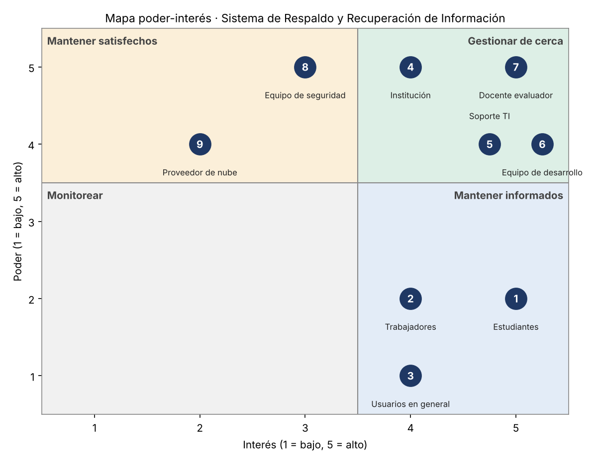

# Sección 03 — Interesados / stakeholders

> **Semana:** 4 · **Responsable:** Xavier Fernández Zúñiga · **Estado:** Borrador · **Jira:** API-22

## Identificación de interesados

Los interesados se identificaron en el taller de la Semana 4. Poder e interés se valoran de 1 (bajo) a 5 (alto).

| # | Interesado | Necesidad | Poder | Interés | Actitud | Estrategia |
|---|---|---|---|---|---|---|
| 1 | Estudiantes | Proteger trabajos y tareas, y recuperarlos rápido | 2 | 5 | Favorable | Mantener informados: usarlos como grupo de prueba |
| 2 | Trabajadores | Continuidad de su trabajo sin perder archivos | 2 | 4 | Favorable | Mantener informados: capacitación breve |
| 3 | Usuarios en general | Una herramienta funcional que facilite el trabajo | 1 | 4 | Neutral | Mantener informados: guías sencillas |
| 4 | Institución / organización | Cumplir normas, reducir pérdidas y controlar costos | 5 | 4 | Favorable | Gestionar de cerca |
| 5 | Soporte TI | Operar el sistema y recibir alertas útiles sin aumentar su carga | 4 | 5 | Neutral | Gestionar de cerca: involucrarlos en el diseño |
| 6 | Equipo de desarrollo | Entregar un producto funcional en la fecha estimada | 4 | 5 | Neutral | Gestionar de cerca: reuniones y roles definidos |
| 7 | Docente evaluador | Que se apliquen bien los conceptos de gestión de proyectos | 5 | 5 | Favorable | Gestionar de cerca: entregas con avances a tiempo |
| 8 | Equipo de seguridad | Que los respaldos protejan los datos personales | 5 | 3 | Neutral | Mantener satisfecho: consultar requisitos de cifrado y acceso |
| 9 | Proveedor de nube | Vender o mantener su servicio | 4 | 2 | Neutral / exigente | Mantener satisfecho: comparar opciones antes de elegir |

### Casos discutibles

- **Equipo de seguridad (poder 5, interés 3):** no sigue el día a día del proyecto, pero puede bloquearlo si los respaldos no cumplen con la privacidad de los datos, una de las restricciones de la [Sección 02](02-contexto-restricciones.md).
- **Proveedor de nube (poder 4, interés 2):** tiene poder porque, si se usa la nube como destino, el proyecto dependería de su servicio y sus costos; su interés es bajo porque el proyecto sería un cliente pequeño.
- **Usuarios en general (poder 1):** se separan de estudiantes y trabajadores porque representan a personas fuera de una organización, que deciden solas si adoptan la herramienta.

## Mapa de interesados (poder / interés)

Se considera alto un valor de 4 o 5.

| Cuadrante | Interesados |
|---|---|
| Gestionar de cerca (poder alto, interés alto) | Institución, Soporte TI, Equipo de desarrollo, Docente evaluador |
| Mantener satisfechos (poder alto, interés bajo o medio) | Equipo de seguridad, Proveedor de nube |
| Mantener informados (poder bajo, interés alto) | Estudiantes, Trabajadores, Usuarios en general |
| Monitorear (poder bajo, interés bajo) | Ninguno |

> **Nota:** en el taller, el mapa y el registro tenían valores distintos para cuatro interesados. Se unificaron tomando los valores del registro, que son los que tienen justificación.

## Estrategia de gestión: interesados críticos

| Interesado | Por qué es crítico | Cómo lo involucramos | Riesgo que cubre |
|---|---|---|---|
| Institución / organización | Decide si el sistema se adopta y aporta el presupuesto, que es bajo. | Presentar el caso de negocio (pérdidas evitadas frente al costo), proponer un piloto pequeño e informar en hitos con métricas como el tiempo de recuperación. | Falta de respaldo institucional y de recursos |
| Estudiantes | Son los primeros usuarios reales; si la herramienta no es fácil, no la usan. | Encuestas cortas de necesidades, pruebas de usabilidad en las Sprint Review y una guía visual de una página. | Baja adopción |
| Soporte TI | Opera el sistema y atiende los incidentes. | Entrevista inicial para definir qué alertas necesita y validación del prototipo de alertas (HU-09) y restauración (HU-04, HU-05). | Fallas no detectadas |

El **equipo de seguridad** se mantiene en vigilancia especial: se le consultará al definir cómo se protegen los respaldos (cifrado y acceso).
