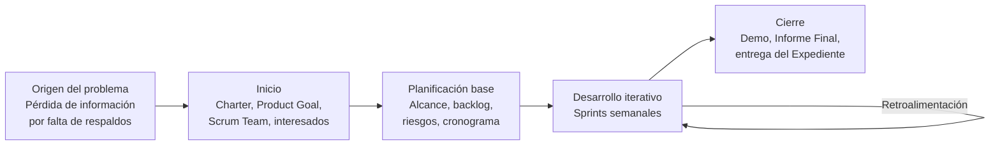

# Sección 04 — Ciclo de vida del proyecto y primer Sprint

> **Semana:** 5 · **Responsable:** Xavier Fernández Zúñiga · **Estado:** Borrador · **Jira:** API-23

## Ciclo de vida seleccionado y justificación

El proyecto sigue un **ciclo de vida híbrido**:

- **Predictivo** en lo que ya es estable: las restricciones (presupuesto bajo, privacidad de datos, compatibilidad con distintos sistemas), el objetivo del proyecto y las fechas fijas de entrega del curso. Esto se planifica desde el inicio.
- **Adaptativo** en el desarrollo del producto: las funciones de respaldo, restauración y alertas se construyen en Sprints semanales con Scrum, porque el principal riesgo (baja adopción) solo se comprueba probando con usuarios y ajustando según su retroalimentación.

### Mapa del ciclo de vida

| Fase | Qué ocurre | Enfoque |
|---|---|---|
| Origen del problema | El equipo identifica que personas y organizaciones pierden información por no contar con respaldos ante fallas, robos, virus o borrados accidentales. | — |
| Inicio | Project Charter, Product Goal, conformación del Scrum Team e identificación de interesados. | Predictivo |
| Planificación base | Alcance, Product Backlog inicial, riesgos, estimaciones y cronograma general. | Predictivo |
| Desarrollo iterativo | Sprints de una semana: se construye, se revisa y se ajusta según la retroalimentación. | Adaptativo |
| Cierre | Demo del incremento, Informe Final, entrega del Expediente y defensa oral (Semana 13). | Predictivo |

## Primer Sprint: Sprint Goal

**Sprint 1 · Duración:** 1 semana (28 de octubre al 3 de noviembre de 2026)

> **Sprint Goal:** Dejar lista la base técnica del proyecto y comprobar que el sistema puede copiar una carpeta a un destino y registrar el resultado.

El primer Sprint se enfoca en **historias habilitadoras**: tareas que todavía no entregan una función al usuario, pero preparan el entorno y reducen la incertidumbre técnica para poder construir el producto en los siguientes Sprints.

| ID | Jira | Historia habilitadora | Prioridad |
|---|---|---|---|
| HB-01 | API-8 | Definir la tecnología del producto (lenguaje, tipo de aplicación y librerías) y justificar la elección según las restricciones del proyecto. | Alta |
| HB-02 | API-9 | Configurar el entorno de desarrollo y la estructura del código en la carpeta `src/` del repositorio. | Alta |
| HB-03 | API-10 | Configurar el tablero de Jira: crear los Sprints y ordenar el backlog. | Alta |
| HB-04 | API-11 | Realizar una prueba técnica: copiar una carpeta local a un destino y registrar en un archivo si la operación fue exitosa o falló. | Alta |

### Por qué empezamos por estas

- **Sin base técnica no se puede construir:** elegir la tecnología y preparar el entorno es requisito para todo lo demás.
- **Reducen el riesgo técnico temprano:** la prueba técnica confirma que el respaldo es posible y permite verificar pronto la compatibilidad con distintos sistemas, una de nuestras restricciones.
- **Dan transparencia desde el inicio:** con el tablero de Jira, el avance de cada Sprint queda visible para el equipo y el docente.

### Planificación tentativa de los siguientes Sprints

| Sprint | Fechas | Enfoque |
|---|---|---|
| Sprint 1 | 28 oct – 3 nov | Historias habilitadoras (base técnica). |
| Sprint 2 | 4 – 10 nov | Respaldo manual: configurar origen y destino, ejecutar el respaldo y ver el resultado (HU-01 a HU-03). |
| Sprint 3 | 11 – 17 nov | Restauración completa y de archivos específicos (HU-04, HU-05). |
| Sprint 4 | 18 – 24 nov | Respaldos automáticos programados e historial (HU-06, HU-07). |
| Sprint 5 | 25 nov – 1 dic | Verificación de integridad y alertas (HU-08, HU-09). |
| Sprint 6 | 2 – 8 dic | Estabilización, pruebas finales y preparación de la Demo. |

Esta planificación se ajustará al cierre de cada Sprint, según lo aprendido.

## Duración y eventos Scrum

| Evento | Cómo lo aplicamos |
|---|---|
| Sprint | 1 semana, alineado con las sesiones del curso. |
| Sprint Planning | Al inicio de cada Sprint: elegimos ítems del backlog en Jira y definimos el Sprint Goal. |
| Daily Scrum | Chequeo corto por mensaje: qué avancé, qué haré, qué me bloquea; se refleja moviendo las tarjetas en Jira. |
| Sprint Review | Al final de cada Sprint mostramos lo avanzado y recogemos retroalimentación. |
| Sprint Retrospective | Al cierre de cada Sprint: qué funcionó y qué mejorar. |

Los registros de cada evento se guardan en `scrum/sprints/`.
