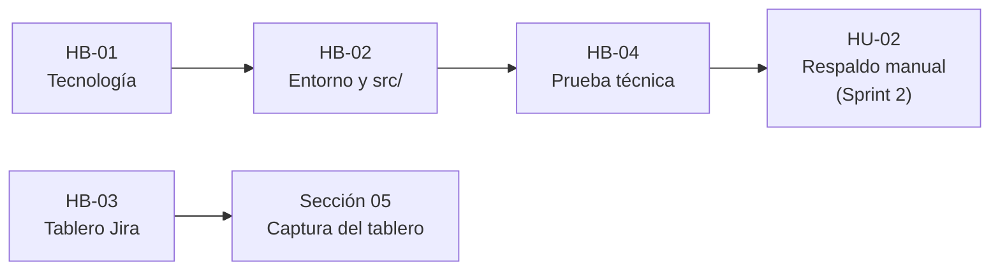

# Sección 05 — Backlog inicial, Sprint Backlog y mecanismo de seguimiento

> **Semana:** 6 · **Responsable:** Xavier Fernández Zúñiga · **Estado:** Borrador · **Jira:** API-24

## Backlog inicial

El backlog se gestiona en **Jira**, en el proyecto `API`, y se organiza en épicas. Cada épica agrupa elementos relacionados con un objetivo del Project Charter ([Sección 00](00-portada-equipo.md)).

| Épica | Jira | Qué agrupa | Elementos |
|---|---|---|---|
| Base técnica del producto | API-2 | Historias habilitadoras del Sprint 1 | HB-01 a HB-04 |
| Configuración y respaldo manual | API-3 | Configurar origen y destino, ejecutar un respaldo y ver su resultado | HU-01 a HU-03 |
| Restauración de información | API-4 | Recuperar un respaldo completo o archivos específicos | HU-04, HU-05 |
| Respaldos automáticos programados | API-5 | Ejecutar respaldos sin intervención del usuario | HU-06 |
| Verificación, alertas e historial | API-6 | Historial de operaciones, integridad y avisos de fallo | HU-07 a HU-09 |
| Expediente del Proyecto | API-1 | Redacción de las secciones 00 a 12 y registro de eventos Scrum | Una tarea por sección |
| Cierre | API-7 | Demo, Informe Final y defensa | 3 tareas |

El detalle de cada historia de usuario, su prioridad y sus criterios de aceptación está en la [Sección 06](06-alcance-product-backlog.md).

### Tipos de elementos en Jira

| Tipo | Uso en el proyecto | Ejemplo |
|---|---|---|
| Épica | Agrupa trabajo con un mismo objetivo. | API-4 · Restauración de información |
| Historia | Funcionalidad con valor para el usuario, escrita como historia de usuario. | API-15 · HU-04 Restaurar un respaldo completo |
| Tarea | Trabajo técnico o de documentación (historias habilitadoras y secciones del Expediente). | API-8 · HB-01 Definir la tecnología |
| Error | Defecto encontrado durante las pruebas; se registra cuando aparece. | — |

## Sprint Backlog — Sprint 1

**Fechas:** 28 de octubre al 3 de noviembre de 2026

> **Sprint Goal:** Dejar lista la base técnica del proyecto y comprobar que el sistema puede copiar una carpeta a un destino y registrar el resultado.

| Jira | Elemento | Responsable | Puntos |
|---|---|---|---|
| API-8 | HB-01 · Definir la tecnología del producto | Xavier | 2 |
| API-9 | HB-02 · Configurar el entorno y la estructura del código en `src/` | Xavier | 2 |
| API-10 | HB-03 · Configurar el tablero de Jira: crear sprints y ordenar el backlog | María Paz | 1 |
| API-11 | HB-04 · Prueba técnica: copiar una carpeta y registrar el resultado | María Paz | 3 |
| API-21 | Corregir Secciones 00 y 01 y definir roles Scrum | María Paz | — |
| API-22 | Sección 03 — Interesados | Xavier | — |
| API-23 | Ajustar Sección 04 — Jira como tablero | Xavier | — |
| API-24 | Sección 05 — Backlog y seguimiento | Xavier | — |
| API-25 | Sección 06 — Alcance y Product Backlog | María Paz | — |
| API-26 | Registrar los eventos Scrum del Sprint 1 | Xavier | — |

Los puntos de historia se usan solo en el trabajo del producto (8 puntos en este Sprint). Las tareas del Expediente se controlan por fecha de entrega.

### Por qué estos elementos

- **Las historias habilitadoras son requisito para todo lo demás:** sin tecnología definida ni entorno configurado no se puede construir ninguna historia de usuario.
- **HB-04 reduce el mayor riesgo técnico:** confirma que la copia de archivos y el registro del resultado funcionan antes de comprometer funciones más complejas.
- **El Expediente está atrasado:** las secciones 03, 05 y 06 se incluyen en este Sprint para ponerse al día con el calendario del curso.
- **Las historias de usuario (HU-01 en adelante) quedan para el Sprint 2**, porque dependen de HB-01, HB-02 y HB-04.

### Dependencias

## Mecanismo de seguimiento

El equipo da seguimiento al trabajo con **Jira (plan gratuito)**, conectado con el repositorio de GitHub mediante las claves de los tickets.

### Por qué Jira

- Tiene backlog, Sprints, tablero y reportes ágiles de forma nativa, lo que encaja con el ciclo de vida híbrido y los Sprints semanales definidos en la [Sección 04](04-ciclo-vida-primer-sprint.md).
- Su plan gratuito admite hasta 10 usuarios, por lo que cumple la restricción de presupuesto bajo.
- Fue la herramienta recomendada en la investigación de herramientas de gestión de proyectos realizada en el curso.

### Cómo funciona

| Elemento | Uso |
|---|---|
| **Tablero del Sprint** | Columnas *Por hacer*, *En curso* y *Listo*. Cada integrante mueve sus tarjetas cuando cambia el estado de su trabajo. |
| **Responsable y fecha** | Cada ticket tiene un responsable y una fecha de entrega, visibles en el tablero. |
| **Etiquetas** | `sprint-1`, `sprint-2`… para planificar; `expediente`, `producto`, `habilitadora` y `cierre` para filtrar por tipo de trabajo. |
| **Daily Scrum** | Chequeo corto por mensaje (qué avancé, qué haré, qué me bloquea). Un bloqueo se marca en Jira con la bandera *Impediment*. |
| **Reportes** | Al cerrar cada Sprint se revisa el reporte del Sprint y el gráfico de trabajo pendiente (burndown) para la Sprint Review. |
| **Relación con el repositorio** | Cada commit incluye la clave del ticket en el mensaje (ej. `API-22 docs(expediente): sección 03 - interesados`), para poder rastrear qué cambio corresponde a qué tarea. |
| **Evidencias** | Al final de cada Sprint se guarda una captura del tablero en `evidencias/` y los registros de los eventos en `scrum/sprints/`. |

### Regla de "Listo"

Un elemento pasa a *Listo* solo cuando cumple todos sus criterios de aceptación y su resultado está subido al repositorio. La Definition of Done completa se definirá en la Sección 09.

<!-- PENDIENTE (API-10): agregar la captura del tablero en evidencias/jira-sprint-01.png -->
