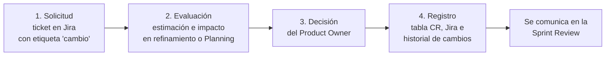

# Sección 11 — Decisiones, cambios y evidencias

> **Semana:** 10 (Registro de Solicitudes de Cambio) · 12 (resto de la sección) · **Responsable:** Xavier Fernández Zúñiga · **Estado:** Borrador · **Jira:** API-39, API-31, API-33

## Registro de decisiones

Decisiones que afectan el producto o la forma de trabajar. Los cambios de alcance o de fecha tienen además su CR en la tabla de [Control de cambios](#control-de-cambios).

| ID | Fecha | Decisión | Alternativas que se descartaron | Por qué | Quién decidió | Evidencia |
|---|---|---|---|---|---|---|
| D-01 | 28 oct 2026 | Usar Jira (plan gratuito) para el backlog, los Sprints y el tablero | GitHub Projects, Trello | Tiene Sprints, tablero y reportes ágiles sin costo, y se conecta con el repositorio por la clave del ticket | Equipo | CR-01, [Sección 05](05-backlog-sprint-backlog.md) |
| D-02 | 18 nov 2026 | Entregar un MVP con HU-01 a HU-04 | Intentar las 9 historias | Al cierre del Sprint 1 no había código. Con respaldar y restaurar ya se cumple lo central del Product Goal | Product Owner | CR-03, [acta del Sprint 1](../scrum/sprints/sprint-01/acta-review-retrospective.md) |
| D-03 | 22 nov 2026 | El producto es una aplicación de escritorio en Python 3 con Tkinter, usando solo la librería estándar | Aplicación web; script de línea de comandos | No necesita servidor ni instalar librerías, funciona en Windows, Linux y macOS, y los datos no salen de la computadora del usuario (restricciones de presupuesto y privacidad de la [Sección 02](02-contexto-restricciones.md)). Una ventana es más fácil de usar que la línea de comandos para alguien no técnico | Product Owner, en la sesión técnica | API-8, API-37, commit `2f4fdbf` |
| D-04 | 22 nov 2026 | Cada respaldo se guarda en una carpeta nueva con la fecha y la hora (`respaldo_AAAA-MM-DD_HH-MM-SS`) y un `manifiesto.json` con la lista de archivos | Sobrescribir siempre el mismo respaldo | No se pierden versiones anteriores y se puede elegir cuál restaurar (HU-04) | Equipo | `src/respaldo/nucleo.py`, prueba `test_respaldos_no_se_sobrescriben` |
| D-05 | 22 nov 2026 | Si un archivo no se puede copiar, el respaldo sigue con los demás y termina como *EXITO PARCIAL*, con el archivo anotado en el log | Detener todo el respaldo ante el primer error | Un solo archivo abierto o bloqueado no debe dejar sin respaldo el resto de la información | Equipo | Prueba `test_un_archivo_con_error_no_detiene_el_respaldo` |
| D-06 | 22 nov 2026 | Antes de restaurar, el sistema avisa si hay archivos con el mismo nombre en el destino y pide confirmación para reemplazarlos | Reemplazar sin preguntar | Evita borrar por accidente una versión más nueva de un archivo | Equipo | Criterios de HU-04 en la [Sección 06](06-alcance-product-backlog.md), prueba `test_restaurar_pide_confirmacion_si_hay_archivos_iguales` |

## Control de cambios

### Cómo se maneja un cambio

En Scrum un cambio no se trata como una excepción: se convierte en un elemento del Product Backlog y compite con el resto del trabajo según su valor. Este es el camino que sigue:

| Paso | Quién | Qué se hace |
|---|---|---|
| 1. Solicitud | Cualquiera: los integrantes, el docente o un interesado | Se crea un ticket en Jira con la etiqueta `cambio` y se agrega una fila a la tabla de abajo con el siguiente ID (CR-01, CR-02…) |
| 2. Evaluación | Todo el equipo | En el refinamiento o en el Sprint Planning se estima el cambio en puntos y se anota su impacto en alcance, tiempo, costo y riesgo |
| 3. Decisión | Product Owner (Xavier) | Decide si se aprueba, se difiere o se rechaza, y si se aprueba lo ordena en el backlog. Si el cambio mueve una fecha de entrega del curso, se consulta antes al docente |
| 4. Registro | Quien hizo la solicitud | Actualiza la tabla, el ticket y el [historial de cambios](historial-de-cambios.md). El PO comunica la decisión en la siguiente Sprint Review |

Un cambio aprobado no entra al Sprint en curso salvo que el equipo esté de acuerdo y saque del Sprint algo del mismo tamaño.

### Registro de Solicitudes de Cambio

| ID | Fecha | Solicitante | Descripción | Impacto | Decisión y justificación | Responsable | Sprint |
|---|---|---|---|---|---|---|---|
| CR-01 | 28 oct 2026 | Equipo | Usar Jira como tablero de seguimiento en lugar de GitHub Projects, como decía la Sección 04 | **Alcance:** ninguno en el producto. **Tiempo:** cerca de 1 hora para configurar. **Costo:** $0, plan gratuito. **Riesgo:** dependemos de un servicio de terceros (R-09) | **Aprobado.** Jira trae backlog, Sprints y reportes sin configurar nada extra, y fue la herramienta recomendada en la investigación de herramientas del curso | Xavier | Sprint 1 |
| CR-02 | 1 nov 2026 | Equipo | Mover el Sprint 1 del 28 oct–3 nov al 1–10 nov y correr los Sprints siguientes | **Alcance:** sin cambio. **Tiempo:** una semana más tarde que el plan. **Costo:** sin cambio. **Riesgo:** queda menos margen antes de la entrega (R-01) | **Aprobado.** El Sprint todavía no se había iniciado en Jira. Así quedó alineado con las clases de los miércoles | María Paz | Sprint 1 |
| CR-03 | 18 nov 2026 | Product Owner | Reducir el alcance de la entrega a HU-01, HU-02, HU-03 y HU-04 (respaldo manual y restauración completa). HU-05 a HU-09 quedan diferidas | **Alcance:** baja de 32 a 13 puntos. **Tiempo:** pasa de 104 a 44 horas estimadas. **Costo:** baja en la misma proporción. **Riesgo:** baja R-01 (atraso); sube R-04 y R-07, porque no habrá respaldos automáticos ni alertas | **Aprobado** en la Review del 18 de noviembre. Al cierre del Sprint 1 no hay código y no es realista terminar las 9 historias. Con HU-01 a HU-04 el usuario ya puede respaldar y recuperar su información, que es el centro del Product Goal | Xavier | Sprint 2 |
| CR-04 | 18 nov 2026 (caso simulado) | Usuario de prueba | Que la herramienta respalde directo a Google Drive | **Alcance:** historia nueva de unos 8 puntos. **Tiempo:** más de 20 horas (autenticación, API de Drive). **Costo:** posible pago si se pasa del espacio gratuito. **Riesgo:** sube R-08 (datos personales en un tercero) y R-09 | **Rechazado.** Va contra dos restricciones de la Sección 02 (sin infraestructura en la nube y presupuesto bajo) y está fuera de alcance según la Sección 06. Como alternativa, el usuario puede elegir como destino una carpeta que ya sincronice con Drive | Xavier | — |

## Evidencias

| Evidencia | Dónde está |
|---|---|
| Acta de Sprint Review y Retrospective del Sprint 1 | [`scrum/sprints/sprint-01/acta-review-retrospective.md`](../scrum/sprints/sprint-01/acta-review-retrospective.md) |
| Acta de Sprint Review y Retrospective del Sprint 2 | [`scrum/sprints/sprint-02/acta-review-retrospective.md`](../scrum/sprints/sprint-02/acta-review-retrospective.md) |
| Prueba manual del MVP (24 nov) | [`evidencias/demo-mvp-2026-11-24.png`](../evidencias/demo-mvp-2026-11-24.png) y [Sección 09](09-calidad-dod.md) |
| Código del MVP | [`src/`](../src) (cómo ejecutarlo en el [README](../README.md)) |
| Pruebas automáticas (9 pruebas, todas pasan) | [`tests/test_nucleo.py`](../tests/test_nucleo.py) |
| Relación entre commits y tickets | `git log`: los commits del Sprint 2 empiezan con la clave `API-` |
| Working Agreements firmados por los dos | [Sección 10](10-comunicacion-responsabilidades.md), commit `9ec400b` con `Co-authored-by` |
| Historial de cambios del Expediente | [`historial-de-cambios.md`](historial-de-cambios.md) |
| Tablero de Jira | Proyecto `API` en Jira, captura en [`evidencias/jira-sprint-02.png`](../evidencias/jira-sprint-02.png) |

## Preparación de la Demo

**Qué se muestra:** el MVP funcionando de punta a punta: configurar, respaldar, ver el resultado, perder un archivo y recuperarlo. Duración: unos 5 minutos.

**Antes de la Demo**

- Una carpeta `demo-origen` con 4 archivos: `clientes.txt`, `notas de reunión.txt` y una subcarpeta `Facturas` con `factura-001.txt` y `factura-002.txt`. Los nombres con espacios, tildes y subcarpetas muestran que el respaldo los soporta.
- Una carpeta `demo-destino` vacía.
- Probar una vez que `python src/main.py` abre la ventana en la computadora de la exposición.

**Guion**

| # | Paso | Historia | Qué debe verse |
|---|---|---|---|
| 1 | Abrir la aplicación con `python src/main.py` | — | La ventana con las tres partes: Configuración, Respaldo y Respaldos disponibles |
| 2 | Elegir `demo-origen` y `demo-destino` y guardar la configuración | HU-01 | Abajo aparece "Configuración guardada.". Si una carpeta no existe, el sistema muestra un aviso |
| 3 | Clic en *Respaldar ahora* | HU-02 | La barra de avance y luego el mensaje *EXITO* con 4 archivos |
| 4 | Clic en *Ver log* | HU-03 | La línea del respaldo con fecha, estado, cantidad de archivos y tamaño |
| 5 | Borrar `clientes.txt` de `demo-origen` | — | El archivo ya no está |
| 6 | Elegir el respaldo en la lista y clic en *Restaurar...*, con `demo-origen` como destino | HU-04 | El aviso de archivos con el mismo nombre; al confirmar, `clientes.txt` vuelve a aparecer |
| 7 | Correr `python -m unittest discover -s tests -v` | — | Las 9 pruebas pasan |

**Si algo falla en la exposición:** se muestran las pruebas automáticas y el log en `~/.sistema-respaldo/respaldos.log`, que dejan evidencia de que el respaldo y la restauración funcionan.

**Qué no incluye esta versión:** restaurar archivos sueltos, respaldos automáticos, verificación de integridad y alertas (HU-05 a HU-09, diferidas por CR-03).
