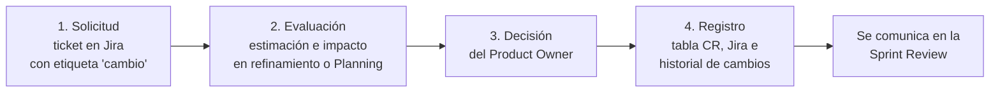

# Sección 11 — Decisiones, cambios y evidencias

> **Semana:** 10 (Registro de Solicitudes de Cambio) · 12 (resto de la sección) · **Responsable:** Xavier Fernández Zúñiga · **Estado:** Borrador · **Jira:** API-39

## Registro de decisiones

_Pendiente._

## Control de cambios

### Cómo se maneja un cambio

En Scrum un cambio no se trata como una excepción: se convierte en un elemento del Product Backlog y compite con el resto del trabajo según su valor. Este es el camino que sigue:

| Paso | Quién | Qué se hace |
|---|---|---|
| 1. Solicitud | Cualquiera: los integrantes, el docente o un interesado | Se crea un ticket en Jira con la etiqueta `cambio` y se agrega una fila a la tabla de abajo con el siguiente ID (CR-01, CR-02…) |
| 2. Evaluación | Todo el equipo | En el refinamiento o en el Sprint Planning se estima el cambio en puntos y se anota su impacto en alcance, tiempo, costo y riesgo |
| 3. Decisión | Product Owner (Xavier) | Decide si se aprueba, se difiere o se rechaza, y si se aprueba lo ordena en el backlog. Si el cambio mueve una fecha de entrega del curso, se consulta antes al docente |
| 4. Registro | Quien hizo la solicitud | Actualiza la tabla, el ticket y el [historial de cambios](historial-de-cambios.md). El PO comunica la decisión en la siguiente Sprint Review |

Un cambio aprobado no entra al Sprint en curso salvo que el equipo esté de acuerdo y saque del Sprint algo del mismo tamaño.

### Registro de Solicitudes de Cambio

| ID | Fecha | Solicitante | Descripción | Impacto | Decisión y justificación | Responsable | Sprint |
|---|---|---|---|---|---|---|---|
| CR-01 | 28 oct 2026 | Equipo | Usar Jira como tablero de seguimiento en lugar de GitHub Projects, como decía la Sección 04 | **Alcance:** ninguno en el producto. **Tiempo:** cerca de 1 hora para configurar. **Costo:** $0, plan gratuito. **Riesgo:** dependemos de un servicio de terceros (R-09) | **Aprobado.** Jira trae backlog, Sprints y reportes sin configurar nada extra, y fue la herramienta recomendada en la investigación de herramientas del curso | Xavier | Sprint 1 |
| CR-02 | 1 nov 2026 | Equipo | Mover el Sprint 1 del 28 oct–3 nov al 1–10 nov y correr los Sprints siguientes | **Alcance:** sin cambio. **Tiempo:** una semana más tarde que el plan. **Costo:** sin cambio. **Riesgo:** queda menos margen antes de la entrega (R-01) | **Aprobado.** El Sprint todavía no se había iniciado en Jira. Así quedó alineado con las clases de los miércoles | María Paz | Sprint 1 |
| CR-03 | 18 nov 2026 | Product Owner | Reducir el alcance de la entrega a HU-01, HU-02, HU-03 y HU-04 (respaldo manual y restauración completa). HU-05 a HU-09 quedan diferidas | **Alcance:** baja de 32 a 13 puntos. **Tiempo:** pasa de 104 a 44 horas estimadas. **Costo:** baja en la misma proporción. **Riesgo:** baja R-01 (atraso); sube R-04 y R-07, porque no habrá respaldos automáticos ni alertas | **Aprobado** en la Review del 18 de noviembre. Al cierre del Sprint 1 no hay código y no es realista terminar las 9 historias. Con HU-01 a HU-04 el usuario ya puede respaldar y recuperar su información, que es el centro del Product Goal | Xavier | Sprint 2 |
| CR-04 | 18 nov 2026 (caso simulado) | Usuario de prueba | Que la herramienta respalde directo a Google Drive | **Alcance:** historia nueva de unos 8 puntos. **Tiempo:** más de 20 horas (autenticación, API de Drive). **Costo:** posible pago si se pasa del espacio gratuito. **Riesgo:** sube R-08 (datos personales en un tercero) y R-09 | **Rechazado.** Va contra dos restricciones de la Sección 02 (sin infraestructura en la nube y presupuesto bajo) y está fuera de alcance según la Sección 06. Como alternativa, el usuario puede elegir como destino una carpeta que ya sincronice con Drive | Xavier | — |

## Evidencias

- Acta de Sprint Review y Retrospective del Sprint 1: [`scrum/sprints/sprint-01/acta-review-retrospective.md`](../scrum/sprints/sprint-01/acta-review-retrospective.md)

## Preparación de la Demo

_Pendiente._
